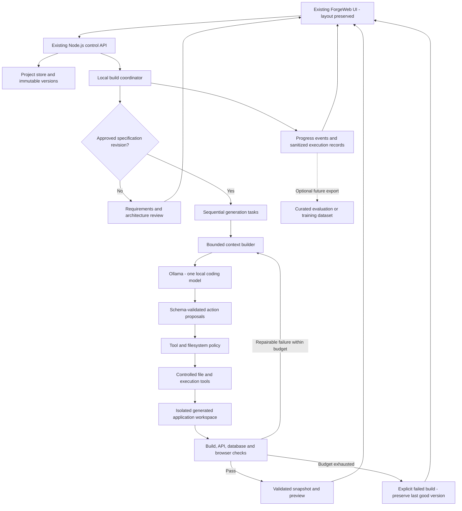
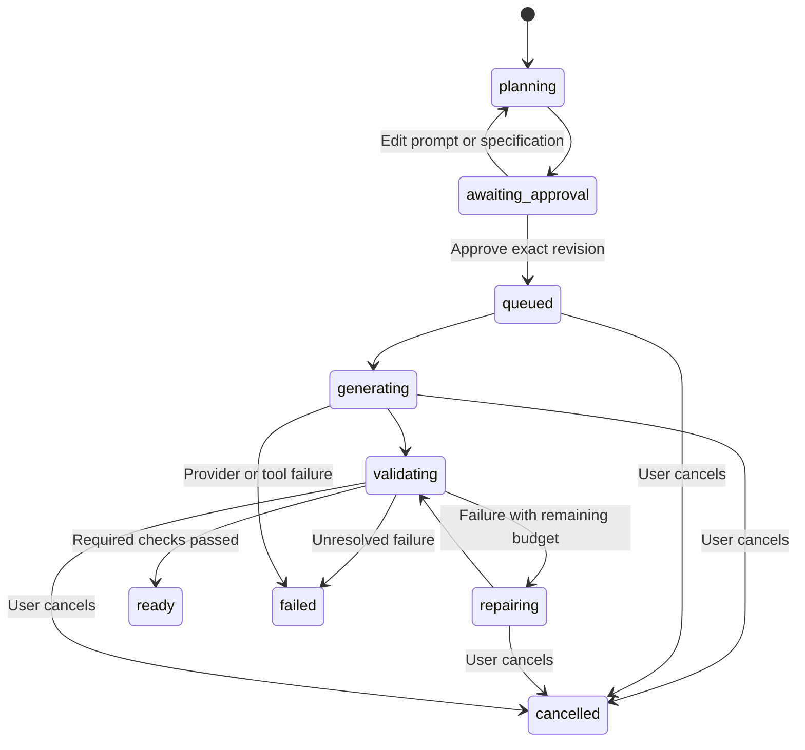
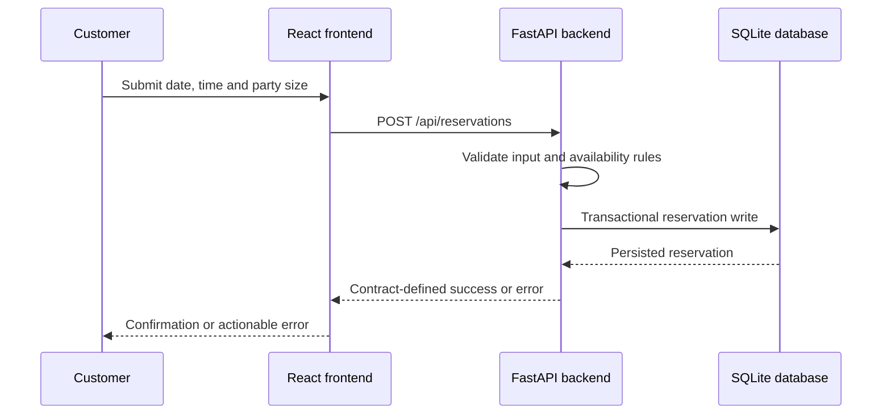

# ForgeWeb Local-Agent Architecture

Status: Proposed implementation architecture, not a completed migration.

Date: 19 October 2026

Scope: Single-user local development and demonstration on an Intel i7-11800H laptop with 16 GB RAM and an NVIDIA RTX 3050 Ti Laptop GPU with 4 GB dedicated VRAM.

This document describes the next local-generation architecture. It does not replace the existing `docs/ARCHITECTURE.md`, assert that local inference is already implemented, or authorize changes to GitHub.

## 1. Objective

Generate customer-specific websites from natural-language requirements using a locally hosted coding model. Produce an approved architecture first, then generate a connected React frontend and Python backend, execute checks, repair bounded failures, and provide a real application preview with inspectable source files.

Preserve ForgeWeb's existing visual design. Improve the generation engine rather than redesigning the host application.

## 2. Non-negotiable boundaries

- Preserve the logo, background animations, navigation, centered composer, history drawer, typography, colors, responsive layout, and workspace tabs.
- Keep architecture review, explicit approval, and Edit prompt behavior.
- Customer-generated applications must follow their own prompt-specific design specifications, not inherit ForgeWeb's theme.
- No cloud-model requests or automatic cloud fallback in local mode.
- Retain existing cloud-provider code without activating it in local mode.
- Do not perform commits, pushes, pulls, remote changes, or other Git/GitHub operations as part of this design.
- Do not call generated code production-ready merely because it compiles.
- Initial scope excludes model training, autonomous deployment, payment-provider onboarding, and simultaneous multi-user builds.

## 3. Existing system versus proposed additions

| Area | Existing baseline | Proposed addition |
|---|---|---|
| Host UI | React/TypeScript, Vite, animated styling, project workspace | Preserve layout; connect existing status surfaces to local execution events |
| Control server | Node.js/TypeScript HTTP handlers and build workflow | Local coordinator and controlled execution tools |
| Model integration | Cloud generation providers and deterministic fallbacks | Explicit Ollama provider with no silent fallback |
| Persistence | Local JSON project store and version snapshots | Durable task checkpoints and sanitized execution records |
| Preview | Generated preview artifacts | Managed execution of actual generated frontend and backend |
| Validation | Existing workflow checks and audit scripts | Contract, persistence, browser, and requirement acceptance checks |
| Learning | No demonstrated locally trained model | Optional future dataset export; no automatic training |

## 4. Reference architectures and selection

| Reference | Useful mechanism | ForgeWeb decision |
|---|---|---|
| FoundationAgents/OpenManus | Tool selection, action execution, observations, incremental edits, bounded agent loop | Primary conceptual reference for execution and repair |
| henryalps/OpenManus | Streamed task events and UI/service separation | Reuse boundary/event concepts, not its UI or placeholder planner |
| OpenManus/OpenManus-RL | Agent trajectories, environment evaluation, training infrastructure | Record measurable execution outcomes now; defer training |

These are distinct projects, not interchangeable versions of one proven website generator. Source inspection is not an execution benchmark. The inspected henryalps coordinator contains a placeholder plan; OpenManus-RL is a training/evaluation project, not a drop-in application generator.

Prefer a small implementation within ForgeWeb's existing server over embedding three overlapping runtimes. Before directly copying code, pin an upstream commit and preserve applicable license/attribution notices. FoundationAgents lists MIT, henryalps lists Unlicense, and OpenManus-RL lists Apache-2.0; independently check dependencies and datasets before redistribution or training.

## 5. System architecture



### Runtime boundaries

1. The host UI communicates only with ForgeWeb's control server, not directly with Ollama or unrestricted tools.
2. The coordinator owns state transitions, approval enforcement, resource budgets, and permitted actions.
3. Ollama proposes content/actions; it does not grant execution permissions or determine verified completion.
4. Generated code runs separately from the control server and receives no host credentials.
5. Generated frontend/backend communication uses the approved application API contract.

## 6. Local model strategy

Initial candidate: **Qwen2.5-Coder-7B-Instruct, Q4_K_M, through Ollama**. The inspected `qwen2.5-coder:7b` package is approximately 4.7 GB and Apache-2.0 licensed. Download size is not runtime memory usage.

This is a provisional hardware-aware choice, not a benchmark-proven best model. It exceeds the laptop's dedicated VRAM and requires partial offloading. Shared GPU memory is system RAM, not additional dedicated VRAM. Free memory before testing; the user's screenshot showed approximately 92% RAM usage.

Initial operating policy:

- One loaded model and one active inference request.
- One active build; queue additional builds.
- Start with a 4,096-token total context budget, reserving space for output and tool definitions; measure before increasing.
- Generate small files or targeted patches rather than a whole repository in one response.
- Use validated structured actions when native tool calling is unreliable.
- Measure generation time, memory use, parse failures, build success, and repair frequency.
- Unload the model before memory-heavy validation if necessary.
- Stop clearly on model unavailability, malformed responses, timeout, or insufficient memory.

The selected model is text-only. Provide browser DOM/style measurements, network failures, and console errors as text. Screenshots are for human inspection; autonomous screenshot interpretation requires a separately evaluated vision model.

Proposed settings, not existing implemented environment variables:

```dotenv
FORGEWEB_GENERATION_MODE=local
FORGEWEB_OLLAMA_URL=http://127.0.0.1:11434
FORGEWEB_LOCAL_MODEL=qwen2.5-coder:7b
FORGEWEB_LOCAL_CONTEXT=4096
FORGEWEB_LOCAL_CONCURRENCY=1
FORGEWEB_LOCAL_MAX_REPAIR_ATTEMPTS=2
```

Use Ollama's native local interface with schema-constrained output initially. Do not confuse this local API with a paid external AI service. Fully offline operation also requires preinstalled models, dependencies, and local assets.

## 7. Build state machine



`ready` means that the declared checks passed for a specific snapshot, not that arbitrary future inputs or production deployment are safe. A preview runtime also has a separate lifecycle: stopped, starting, running, or failed.

Approval stores a specification revision/hash. Generation and resume requests must verify that hash. Prompt edits invalidate affected tasks and approval; retain previous completed versions. Checkpoints include task ID, input hashes, output hashes, model identity, and validation status. Resume only when the recorded dependencies still match.

## 8. Authoritative specification artifacts

| Artifact | Responsibility |
|---|---|
| `requirements.md` | User roles, features, constraints, and acceptance criteria |
| `ARCHITECTURE.md` | Customer application's structure, data flow, and boundaries |
| `design-spec.json` | Colors, fonts, navigation, page composition, spacing, and responsive rules |
| `openapi.yaml` | Paths, HTTP methods, schemas, errors, and authentication expectations |
| `task-manifest.json` | Expected files, dependencies, and task scopes |

These files belong to each generated customer project. Its `ARCHITECTURE.md` is different from this ForgeWeb platform architecture document.

Explicit instructions override defaults. Record unresolved ambiguities rather than inventing unsupported requirements. Obtain confirmation before consequential scope changes. Keep approved specifications read-only to the implementation agent; changes require a new revision.

## 9. Sequential specialist roles

| Role | Inputs | Outputs |
|---|---|---|
| Planner | Prompt and clarifications | Specification artifacts and dependency-ordered tasks |
| Backend implementer | Approved requirements and OpenAPI contract | FastAPI routes, Pydantic schemas, SQLite persistence, backend tests |
| Frontend implementer | Design specification, requirements, typed API client | React/TypeScript pages, styling, forms, and interactions |
| Integrator | Both file sets and contract | Connection configuration and contract verification |
| Reviewer/repair role | Relevant code plus trusted diagnostics | Scoped patch or an explicit unresolved issue |

Roles are separate task contexts using the same model, not concurrent model instances. Model-based review supplements deterministic checks and human review; it is not independent proof of correctness.

## 10. Frontend-backend mapping

The OpenAPI contract is the shared interface authority. Generate a TypeScript client from the contract using a pinned generator, then compare FastAPI's emitted schema with the approved contract. Check runtime responses as well as static shapes.

Example reservation journey:



Require loading, empty, success, and error states. Handle non-2xx responses explicitly. Derive business rules from requirements; endpoint existence alone does not verify availability logic or prevent double booking.

## 11. Tools and safety policy

Expose narrow operations such as `read_project_file`, `apply_project_patch`, `run_frontend_build`, `run_backend_tests`, `inspect_contract`, `start_preview`, `stop_preview`, and `run_browser_scenario`.

- Validate every argument against a schema and enforce server-side authorization.
- Resolve canonical paths, reject traversal and symlink/reparse-point escapes, and restrict access to the current generated project.
- Deny host credentials, `.env.local`, personal directories, Git metadata, and ForgeWeb application source.
- Use fixed command templates and argument arrays, not arbitrary model-provided shell strings.
- Run generated code in an OS-level isolated environment with least privilege, bounded resources, restricted mounts, and network controls.
- A virtual environment, child process, or command allowlist alone is not sufficient isolation.
- Separate dependency preparation from execution; permit only reviewed packages and controlled install scripts.
- Use a disposable browser profile, never the user's normal browser session.
- Treat generated files, retrieved documents, package output, and browser content as untrusted data, not permission-granting instructions.
- If adequate isolation is unavailable, allow source export but block automatic execution and report why.

Container/VM runtime choice remains a deployment decision to validate on this Windows laptop. Do not substitute unisolated execution merely to reduce memory use.

## 12. Preview integration

Use actual generated React and FastAPI processes, not a standalone HTML imitation. A preview manager owns allocated ports, health checks, process IDs, logs, and teardown per project/version.

Prefer a dedicated preview origin and a generated-app proxy for `/api` requests. Do not share host authentication cookies, storage, or credentials with generated applications. Explicitly restrict access from the sandbox to the host control API and model endpoint. An iframe alone is not a complete security boundary.

Keep the existing preview panel and viewport controls. Represent startup failure, backend failure, and stopped previews distinctly. Cancelling or switching a running preview must not orphan processes. Persisted files remain available after a preview stops.

## 13. Persistence and events

Retain ForgeWeb's current JSON project store for the single-user prototype. Add serialized, atomic updates for approval revisions and task checkpoints. Keep large logs and generated files separate from frequently updated metadata. Do not introduce a shared multi-user database claim.

Proposed per-build records:

```text
.forgeweb-data/local-builds/<build-id>/
  manifest.json
  checkpoints.json
  events.jsonl
  validation.json
  workspace/
    requirements.md
    ARCHITECTURE.md
    design-spec.json
    openapi.yaml
    frontend/
    backend/
```

Stream or poll structured events through ForgeWeb's existing event path: `task_started`, `file_updated`, `check_completed`, `repair_started`, `preview_ready`, `build_failed`, and `build_cancelled`. Include build ID, sequence number, timestamp, and concise user-facing message. Persist events so reconnecting clients can resume without replaying execution. Redact credentials and private payloads.

Store observable actions, patches, and tool results rather than requiring hidden model reasoning. Recording traces is not training. Optional dataset export requires user consent, sanitization, license review, and separation of evaluation cases from training examples.

## 14. Implementation path map

Paths below are relative to ForgeWeb's project root. New modules are proposed, not currently implemented.

| Path | Integration responsibility |
|---|---|
| `server/providers/generation-provider.ts` | Explicitly select local adapter; preserve cloud adapters |
| `server/providers/ollama-provider.ts` (new) | Local inference, schema validation, timeouts, cancellation |
| `server/workflow.ts` | Approval boundary and staged coordinator invocation |
| `server/generation/master-prompt.ts` | Focused instructions per role and output format |
| `server/local-agent/coordinator.ts` (new) | Task state, dependencies, checkpoints, budgets |
| `server/local-agent/context-builder.ts` (new) | Relevant contract sections, signatures, and bounded diagnostics |
| `server/local-agent/tool-registry.ts` (new) | Validated operations and policy enforcement |
| `server/local-agent/workspace-tools.ts` (new) | Restricted reads and patches |
| `server/local-agent/contract-validator.ts` (new) | OpenAPI and actual endpoint agreement |
| `server/local-agent/preview-manager.ts` (new) | Isolated frontend/backend lifecycle |
| `server/local-agent/evaluator.ts` (new) | Validation evidence and acceptance gates |
| `server/local-agent/trace-store.ts` (new) | Sanitized events and optional dataset records |
| `server/policy.ts` | Host protection and allowed path/tool checks |
| `server/project-workspace.ts` | Versioned files, export, preview integration |
| `src/components/BuildProposal.tsx` | Existing review/approval UI; preserve presentation |
| `src/components/ProjectWorkspace.tsx` | Existing file/preview UI; connect new statuses |

No second orchestration backend, Next.js migration, mandatory LangGraph dependency, or mandatory MCP service is required initially. MCP may later expose reviewed local tools behind the same policy boundary; it does not itself provide security or visual quality.

## 15. Verification and release gates

| Gate | Required evidence |
|---|---|
| Host layout preservation | Baseline and updated desktop/mobile screenshots; no unintended visual changes |
| Local-only inference | Provider tests and network checks show no cloud fallback |
| Approval | Generation is rejected without approval of the exact specification revision |
| Files | Required files exist; imports and manifests are consistent; paths remain confined |
| Frontend | Type checking and production build succeed |
| Backend | Imports, endpoint tests, input validation, and business-rule tests pass |
| Contract | Paths, methods, schemas, error formats, and client calls agree |
| Persistence | Create/read/update workflows survive refresh and application restart |
| Browser | Required user journeys execute against the real backend |
| Responsive behavior | No unintended overflow or inaccessible key controls at target viewport sizes |
| Design adherence | Requested colors/layout/features match approved specifications |
| Failure handling | Cancellation, timeout, malformed model output, and exhausted repairs are honest and recoverable |
| Isolation | Generated code cannot access secrets or escape project/runtime boundaries |

Trusted acceptance checks must not be editable by the implementation agent. Agent-generated tests are supplemental. A build passes only required checks; preserve the last good snapshot after failure. Human aesthetic review remains necessary with a text-only model.

Evaluate at least a cream client portal, a restaurant reservation application, and a storefront. Their pages and workflows must differ appropriately. A restaurant case must demonstrate persisted reservation creation, not only a clickable button. External payments remain explicitly unconfigured/test-only unless separately integrated.

## 16. Implementation milestones

1. Capture host UI baseline and benchmark local model compatibility, memory, speed, and structured output.
2. Add isolated local provider selection and failure/cancellation tests without removing cloud code.
3. Implement approval-bound task planning, checkpoints, and context limits.
4. Add restricted file tools, isolation capability checks, and contract-first generation.
5. Complete one small React/FastAPI/SQLite vertical slice.
6. Add real preview lifecycle, browser checks, and bounded repair.
7. Validate product diversity, visual preservation, resumability, and export.
8. Consider curated training data and stronger hardware only after baseline reliability is measured.

First acceptance milestone: an approved restaurant specification produces a working reservation form, a real FastAPI endpoint, SQLite persistence, and a passing browser journey using local inference only.

## 17. Architecture decisions

### ADR-01: Extend the existing modular server

Status: Proposed. Keep Node.js/TypeScript coordination rather than embedding all three reference frameworks. This preserves UI/API compatibility and avoids duplicate state stores. Trade-off: implement selected orchestration concepts ourselves. Revisit if a concrete missing capability outweighs integration cost.

### ADR-02: One local model, sequential roles

Status: Proposed. Prioritize memory fit over parallel generation. Trade-off: longer builds. Mitigate with small tasks and checkpoints; revisit after hardware measurements or upgrades.

### ADR-03: Contract-first application generation

Status: Proposed. Freeze an approved OpenAPI contract before implementation. Trade-off: additional planning and schema maintenance. Benefit: fewer mismatched buttons/endpoints; validate actual behavior, not only schema consistency.

### ADR-04: No silent success or provider fallback

Status: Proposed. In local mode, unavailable inference or failed checks must produce an actionable failure. Trade-off: demos may stop instead of showing a generic substitute. Preserve last good versions and expose retry/resume.

### ADR-05: Separate inference from training

Status: Proposed. Use a pretrained model now; record sanitized evidence for possible later training. Trade-off: no automatic weight improvement. Training requires separate compute, datasets, evaluation, and approval.

## 18. Source references

- [FoundationAgents/OpenManus](https://github.com/FoundationAgents/OpenManus)
- [FoundationAgents tool-call loop](https://github.com/FoundationAgents/OpenManus/blob/main/app/agent/toolcall.py)
- [FoundationAgents configuration](https://github.com/FoundationAgents/OpenManus/blob/main/app/config.py)
- [henryalps/OpenManus streaming server](https://github.com/henryalps/OpenManus/blob/main/src/server.py)
- [henryalps/OpenManus coordinator](https://github.com/henryalps/OpenManus/blob/main/src/agents/coordinator.py)
- [OpenManus-RL](https://github.com/OpenManus/OpenManus-RL)
- [OpenManus-RL training example](https://github.com/OpenManus/OpenManus-RL/blob/main/scripts/ppo_train/train_alfworld.sh)
- [Ollama Qwen2.5-Coder 7B package](https://ollama.com/library/qwen2.5-coder:7b)
- [Ollama structured output](https://docs.ollama.com/capabilities/structured-outputs)

References are design inputs, not evidence that the proposed ForgeWeb integration has been built or benchmarked. Pin exact upstream revisions before incorporating source code.
