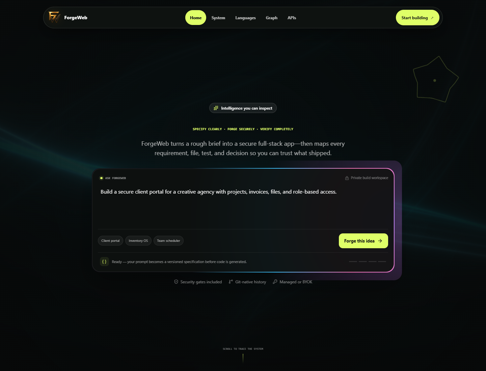
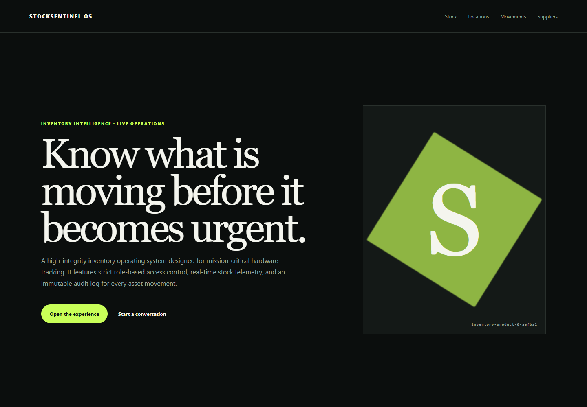
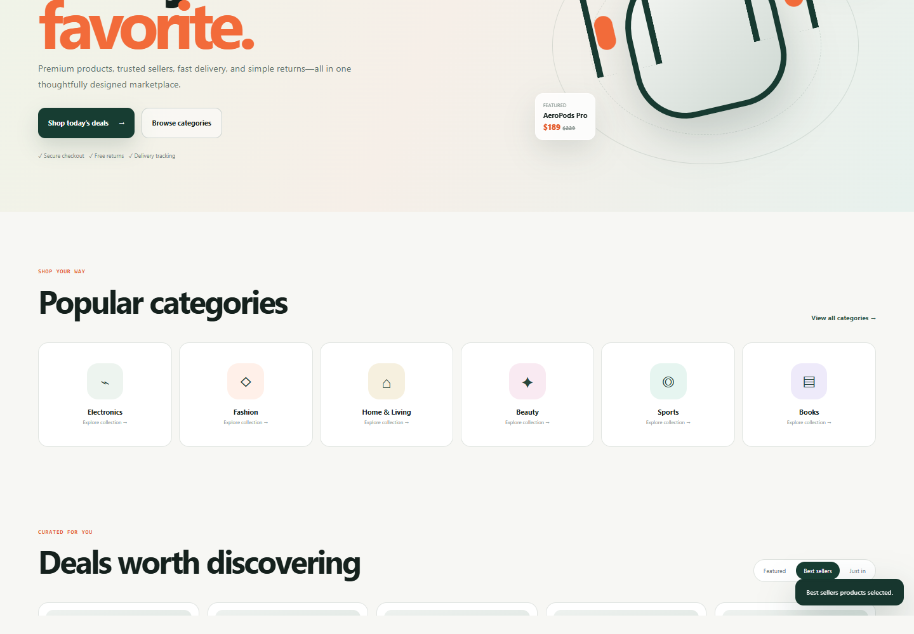
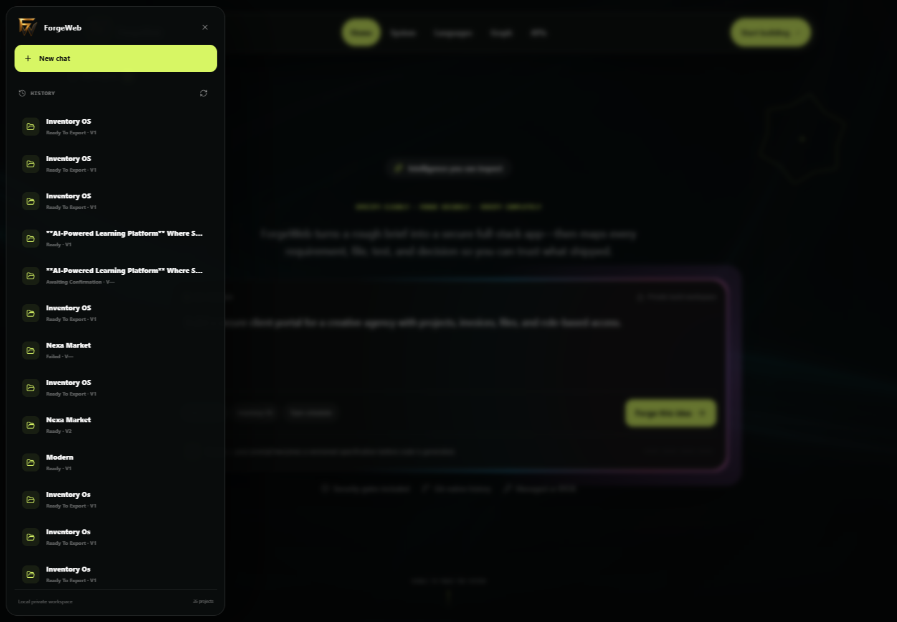
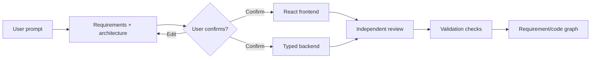

# ForgeWeb

## ForgeWeb source graph (local 3D showcase)

The home page's Graph section shows an actual Graphify code-only snapshot of ForgeWeb's `src`, `server`, `scripts` and selected build configuration—not customer application records. Drag to orbit, use zoom/reset or keyboard arrows, filter communities, search symbols and inspect extracted/inferred relationships. All indexed nodes and connections are rendered; only the text search list is limited to its first 40 matches. A searchable text inspector remains available without WebGL. Automatic rotation is off by default and disabled for reduced-motion preferences.

Stop the dev server, run `npm run graph:refresh` after code changes to regenerate `public/forgeweb-code-graph.json`, then run `npm run dev` again. Stopping Vite first avoids Windows/OneDrive locks on the public snapshot; failed replacement preserves the previous graph. The command uses the installed local `graphify` CLI (reviewed 0.9.97). The generator reads an allowlisted source snapshot, excludes environment files, databases, dependencies, symlinks and Git history, invokes `--code-only`, and publishes only sanitized symbol/relationship metadata. It never invokes an LLM or cloud service. The downloaded original Graphify fork at `https://github.com/Sachin71000/graphify` matched reviewed revision `0a8cd4e1e342235fe53e881fb5d591bf0460071f`.

This is a dated snapshot, not an always-on cloud graph or a proof that every line is correct. CSS does not produce Graphify symbols, display coordinates are generated locally, and inferred edges/confidence scores are not validation results. The public JSON includes source paths and symbol names but no source bodies, API keys or customer records. If hosting ForgeWeb publicly, those code metadata will be visible to visitors; disable/remove the showcase before publishing if those names are confidential. Generated customer-project graphs and their storage are separate and unchanged.

ForgeWeb is an architecture-first, full-stack application generator. A user describes a product, reviews the generated requirements and `ARCHITECTURE.md`, explicitly confirms the plan, and only then does ForgeWeb generate the customer's React frontend and typed backend.



## Generated application preview

ForgeWeb now produces a complete responsive customer-application surface rather than a placeholder hero.



Prompts are classified by product domain before architecture is created. An e-commerce request therefore generates a marketplace experience instead of reusing the dashboard layout.



The workspace history is available from a Codex-style collapsible drawer with New chat and persisted projects.



## What works today

- Prompt-to-requirements compilation with stable requirement IDs.
- Prompt-specific architecture covering frontend, backend, data, security, delivery, and system boundaries.
- Product-intent extraction for commerce, inventory, scheduling, portals, and general applications, including stable product naming and domain entities.
- Staged server-side generation: Gemini plans architecture; Groq then OpenRouter generates the React frontend; Gemini generates the contract-matched Python FastAPI backend. Optional extra Gemini credentials provide service failover.
- Explicit provider failures with bounded retries. Failed AI generation is not silently replaced by a fixed local template.
- A hard `awaiting_confirmation` gate: no source files exist before approval.
- An **Edit prompt** action beside confirmation that returns focus to the original composer before generation.
- React and TypeScript customer-application generation.
- A dedicated premium commerce generator with storefront search, categories, product cards, cart/wishlist navigation, order tracking, trust surfaces, responsive layouts, and admin entry points.
- A Codex-style collapsible top-left drawer with **New chat** and persistent project history.
- Python FastAPI backend contracts, Pydantic validation, role/ownership policy, and audit boundaries.
- Customer-app capability planning for React, Git, GSAP, Anime.js, and reviewed React Bits patterns.
- Karpathy-derived coding discipline, gstack-informed tasks, and Ruflo-inspired planning/handoff/review rules. Ruflo swarm execution is not enabled.
- Independent scope and traceability review.
- Deterministic validation and a requirement-to-file evidence graph.
- Persistent local projects, immutable version snapshots, and safe restore in an atomic JSON store.
- A real sandboxed professional application preview generated from the approved specification, with centered navigation, dashboard surfaces, and desktop/tablet/mobile controls.
- Automatic, validated compatibility upgrades for older saved projects that predate frontend previews or the current project layout.
- Prompt-scoped project edits that validate before creating a new version and preserve the last working version on failure.
- Generated-application database information kept separate from ForgeWeb's control-plane storage.
- Validation-gated ZIP export containing the actual files from the selected project version.
- Responsive animated ForgeWeb interface with reduced-motion behavior.

## Generation flow



The confirmation boundary is enforced by the backend state machine. It is not merely a disabled frontend button.

## Technology

| Area | Technology |
|---|---|
| Platform UI | React 19, TypeScript, Vite, Tailwind CSS |
| Motion | GSAP, Anime.js, Motion, Three.js/OGL |
| Control plane | Node.js, TypeScript, native HTTP server |
| Persistence | Atomic local JSON store |
| Validation | Node test runner, TypeScript, custom UI audit with Playwright |
| Generated apps | React/TypeScript frontend and Python FastAPI backend artifacts linked by `shared/api-contract.json` |

## Requirements

- Node.js 22 or newer
- pnpm 10 or newer
- Google Chrome only when running the optional visual UI audit

If pnpm is not installed:

```powershell
corepack enable
corepack prepare pnpm@latest --activate
```

## Prompt-specific AI generation

Prompt-unique generation requires available model providers. The recommended mapping uses Gemini for architecture/backend and Groq then OpenRouter for frontend. The optional deterministic mode is a separate demonstration mode, not a substitute for successful AI generation. Copy `.env.example` to `.env.local` only on first setup; never overwrite an existing key file:

```powershell
Copy-Item .env.example .env.local
```

```dotenv
GROQ_API_KEY=your_rotated_key_here
OPENROUTER_API_KEY=your_rotated_key_here
GEMINI_API_KEY=your_rotated_key_here
GEMINI_FALLBACK_API_KEY_1=
GEMINI_FALLBACK_API_KEY_2=
FORGEWEB_GROQ_MODEL=qwen/qwen3.8-27b
FORGEWEB_OPENROUTER_MODEL=openai/gpt-5.3-codex
FORGEWEB_GEMINI_MODEL=gemini-3-flash-preview
FORGEWEB_GENERATION_MODE=frontend-dual-gemini-backend
# Optional when Gemini quota is unavailable:
# FORGEWEB_BACKEND_PROVIDER=groq
```

Vite loads `.env.local` before it constructs the embedded development API. Provider keys remain in the Node server and are never returned to the browser, written to generated projects, or included in ZIP exports. The run commands use Node's system CA store for secure provider connections on inspected Windows networks; TLS verification remains enabled.

The provider pipeline performs schema-constrained architecture planning before confirmation and modular code generation after confirmation. See [the master generation prompt](./docs/MASTER_GENERATION_PROMPT.md).

Fallback keys are optional and do not bypass Google project quotas. OpenRouter requires sufficient credit for its configured model; a valid key does not guarantee generation quota. Do not paste credentials into chat or commit them.

With `FORGEWEB_BACKEND_PROVIDER=groq`, Groq handles architecture/backend as well as its frontend stage. Each source file is requested separately with at most 800 output tokens and a process-shared 61-second request interval for the same key/model. There are no unpaced automatic network retries in this mode. Per-file activity reports waiting/received states; the combined Files view and original export structure are unchanged. Backend source is syntax-checked before composition. Truncated responses fail explicitly. This is a conservative local pacing policy, not a guarantee of provider quota: other applications or processes may share the account's limits. Builds can take 15–20 minutes or longer when queued. Large individual files and architecture JSON may exceed the small output budget and fail rather than silently losing features. Backend-only retries currently rerun generation; no resumable per-file checkpoints are implemented.

## Current verification and limitations

Backend reliability update (2026-10-29): Gemini now requests five separate plain-source Python files at 2,048 output tokens per file, validates syntax immediately and permits one syntax repair per file. It no longer uses a five-file Base64 bundle. FORGEWEB_BACKEND_PROVIDER=gemini selects enabled Gemini slots followed by Groq; FORGEWEB_GROQ_FILE_MODE=true preserves Groq's existing paced source generation. FORGEWEB_GEMINI_DISABLED_SLOTS=3 skips slot 3 without deleting its key (this machine's slot 3 was confirmed ineligible for the Gemini free tier). Set disabled slots according to your own account, not blindly. Local test count: 117, with type/build checks passing. The new full pipeline has not been live-generated in this update; no end-to-end runtime or speed guarantee is implied.

Local Stitch update (2026-10-28): with FORGEWEB_STITCH_ENABLED=true, the existing confirmation gate now precedes a required Stitch design stage. Failure pauses for retry; it never silently skips Stitch. With the Groq backend override, backend/architecture quota fallback is now Groq -> Gemini 1 -> Gemini 2 -> Gemini 3 (user-confirmed separate projects). Frontend fallback includes all three Gemini credentials after Groq/OpenRouter. This supersedes earlier no-Gemini-backend-fallback notes below. See [Stitch integration](docs/STITCH-INTEGRATION.md) for configuration, security boundaries and test scope.

The latest local regression run passed 79 tests, including provider failure routing, cross-origin rejection, invalid inputs, restart recovery, Python syntax export checks and a curated SQLite booking repair. These tests do not certify arbitrary generated applications as production-ready. Previously reported dependency advisories remain open; see [release audit](docs/PRODUCT-RELEASE-AUDIT.md) and [testing checklist](docs/PROVIDER-SECURITY-TESTING-2026-10-26.md).

The Files tab presents one combined Frontend entry and one Backend entry while preserving actual files in exports. The embedded preview is sandboxed and offline: it is not a running Python backend, and demo interactions must not be mistaken for durable customer transactions. Run and test an exported backend before accepting customer data.

New provider-generated backend support uses SQLite at `data/application.sqlite3` (override `APP_DATABASE_PATH`). Legacy/generated service compatibility still requires runtime testing. Local databases and generated customer exports are excluded from Git.

Optional developer tools (installed separately, not app dependencies):

```powershell
npm install -g ruflo@3.63.3 @alibaba-group/open-code-review@1.13.3
ruflo --version
ocr --version
```

Ruflo-inspired rules are sent to all providers, but its CLI/MCP runtime is not automatically invoked. See [integration boundaries](docs/RUFLO-GENERATION-DISCIPLINE.md). No automatic public deployment is configured by these tools.

## Quick start

```powershell
git clone https://github.com/Sachin71000/forgeweb.git
cd forgeweb
pnpm install
pnpm dev
```

Open [http://127.0.0.1:5173](http://127.0.0.1:5173).

`pnpm dev` starts both the Vite frontend and the local ForgeWeb API. A second terminal is not required.

## How to use it

1. Enter an application idea in the central prompt box.
2. Select **Forge this idea**.
3. Review the generated requirements, architecture summary, capability sources, and `ARCHITECTURE.md`.
4. Select **Edit prompt** to revise the original request, or **Confirm requirements & generate** to approve it.
5. Watch frontend generation, backend generation, review, validation, and graph synchronization complete.
6. Switch between **Files**, **Preview**, **Database**, and **Versions**. Select any generated file to inspect and copy its complete stored source.
7. Use **Edit with AI** for a scoped change, restore any prior version, or validate and create a ZIP.
8. Reload the page and use **My Projects** to reopen the persisted workspace.

Local state is stored at `.forgeweb-data/forgeweb.json`. The directory is ignored by Git.

## Commands

| Command | Purpose |
|---|---|
| `pnpm dev` | Start the frontend and embedded development API at `127.0.0.1:5173` |
| `pnpm typecheck` | Type-check the frontend and server |
| `pnpm test` | Run workflow, policy, persistence, and HTTP tests |
| `pnpm build` | Build the production frontend and compiled API |
| `pnpm preview` | Preview the production frontend build |
| `pnpm dev:api` | Run only the TypeScript API on port `8787` |
| `pnpm build:api` | Compile only the server into `dist-server` |
| `pnpm start:api` | Run the compiled API |
| `node scripts/ui-audit.cjs` | Run responsive, accessibility, interaction, motion, and WebGL browser checks |

Recommended verification before committing:

```powershell
pnpm typecheck
pnpm test
pnpm build
```

Optional full browser audit, after starting `pnpm dev`:

```powershell
node scripts/ui-audit.cjs
```

## HTTP API

| Method | Route | Purpose |
|---|---|---|
| `GET` | `/api/health` | Control-plane readiness and active generation provider |
| `POST` | `/api/builds` | Create requirements and architecture from `{ "prompt": "..." }` |
| `GET` | `/api/builds/:buildId` | Read build stage, proposal, evidence, and events |
| `POST` | `/api/builds/:buildId/confirm` | Approve the proposal and begin source generation |
| `GET` | `/api/builds/:buildId/events` | Stream auditable progress through server-sent events |
| `GET` | `/api/projects` | List persisted projects |
| `GET` | `/api/projects/:projectId` | Read project, specification, generated files, and graph |
| `GET` | `/api/projects/:projectId/workspace` | Read current version, source, version history, and generated database information |
| `GET` | `/api/projects/:projectId/preview` | Render the current stored preview with restrictive isolation headers |
| `POST` | `/api/projects/:projectId/edits` | Validate and apply a scoped edit as a new immutable version |
| `POST` | `/api/projects/:projectId/versions/:versionId/restore` | Restore a validated version |
| `POST` | `/api/projects/:projectId/export/validate` | Validate the current version and return its export summary |
| `POST` | `/api/projects/:projectId/export` | Download a real ZIP of the current version |

Example:

```powershell
$proposal = Invoke-RestMethod `
  -Method Post `
  -Uri http://127.0.0.1:5173/api/builds `
  -ContentType application/json `
  -Body '{"prompt":"Build a secure client portal with projects, invoices, files, and role-based access."}'

$buildId = $proposal.build.id
Invoke-RestMethod -Method Post -Uri "http://127.0.0.1:5173/api/builds/$buildId/confirm"
```

## Repository structure

```text
src/                         ForgeWeb React interface
  components/                Product and reviewed visual components
  lib/forgeweb-api.ts        Typed browser API client
server/                      Local generation control plane
  workflow.ts                Architecture and confirmation state machine
  product-intent.ts          Prompt domain, product-name, and entity inference
  generated-commerce.ts      Dedicated responsive marketplace generator
  generation/master-prompt.ts  Prompt-specific planning and implementation policy
  providers/generation-provider.ts  Groq, OpenRouter, Gemini, routing, and manifest validation
  project-workspace.ts       Preview, scoped edit, version, restore, and export service
  zip.ts                     Dependency-free ZIP writer for stored project files
  policy.ts                  Bounded engineering-agent policy
  app.ts                     HTTP routes and SSE
  store.ts                   Atomic persistence
  tests/                     Workflow and API tests
docs/                        PRD, architecture, ADRs, and implementation plan
scripts/ui-audit.cjs         Multi-viewport browser and generated-app verification
scripts/commerce-preview-fixture.ts  Isolated approved commerce build for visual tests
public/                      Logo and static assets
```

## Architecture and discipline

- [`multica-ai/andrej-karpathy-skills`](https://github.com/multica-ai/andrej-karpathy-skills) is the reviewed source for the shared coding discipline.
- [`garrytan/gstack`](https://github.com/garrytan/gstack) informs the specialist workflow and quality gates.
- [`tirth8205/code-review-graph`](https://github.com/tirth8205/code-review-graph) is the pinned structural graph target behind the graph-adapter boundary.
- React, Git, GSAP, Anime.js, and React Bits are represented as explicit customer-app capabilities with official source links and policy boundaries. ForgeWeb does not claim that ordinary libraries are MCP servers.

Production identity, external model providers, isolated build workers, PostgreSQL/Redis/object storage, Git remotes, and the Python Code Review Graph runner remain deployment adapters. The local implementation does not fake those services.

## Documentation

- [Product requirements](./docs/PRD.md)
- [System architecture](./docs/ARCHITECTURE.md)
- [Implementation plan](./docs/IMPLEMENTATION_PLAN.md)
- [Project workspace implementation plan](./docs/PROJECT_WORKSPACE_IMPLEMENTATION_PLAN.md)
- [Architecture decisions and operating model](./docs/README.md)
- [Third-party notices](./THIRD_PARTY_NOTICES.md)
- [Latest research paper (PDF)](./research-paper/ForgeWeb_Updated_IEEE_References.pdf)
- [Research paper LaTeX and reference notes](./research-paper/README-Supplied-References.md)
- [Phase 2 review presentation](./ForgeWeb_Phase_2_Review_Completed.pptx)

## Security note

### Direct Sol testing

Sol frontend generation is page-by-page: shared API/styles/shell, one source file per approved page, App/navigation, entrypoint, interaction notes and a separate concise static preview. Each validated file is checkpointed and read back before the next request. Retry reuses intact, matching checkpoints and starts at the failed file; changed policy/brief/dependency bodies invalidate the affected checkpoints. A cache write that is unsafe or cannot be verified stops generation instead of silently proceeding. Final whole-project source checks and isolated compilation remain mandatory. The static preview is not proof that a live backend works. This flow has offline recovery tests; it has not yet completed the live café build.

Set `FORGEWEB_GENERATION_MODE=openai` and server-side `OPENAI_API_KEY` in `.env.local` to use `gpt-6.1-sol` through the Responses API. Existing provider settings are preserved but are not paid fallbacks in this mode. The adapter uses Standard service, low reasoning, structured output and no automatic network replay. Whole-application validation failures stop rather than automatically regenerating the application.

The default local test allowance is **$1 cumulative**, not $1 per project or server restart. An explicitly approved extension can be set server-side with `FORGEWEB_OPENAI_TEST_LIMIT_USD` (maximum $2); changing it must not reset the ledger. The TaskNest continuation was approved for exactly $1 additional, giving a cumulative cap of $1.841931. Its SQLite ledger is `<FORGEWEB_DATA_DIR>/openai-test-budget.sqlite3` (default `.forgeweb-data`). Requests reserve an upper-bound cost before sending; uncertain responses retain their reservation. A budget error stops generation before another request that cannot fit. Accounting conservatively prices all input at the documented cache-write rate, so it is not the provider invoice. Do not remove or reset the ledger to resume spending without fresh approval. Provider-side billing protections are still required; this ledger does not cover other programs or services.

### Edit, export and preview safeguards

Configured generation providers now support bounded source patches for AI edits. Changes are saved as a new version only after source validation and isolated React compilation succeed. Invalid, ambiguous or unsupported patches leave the previous version intact. Without a configured editor, the UI explicitly offers styling-only edits. Passing these checks does not prove every requested behavior; review and exercise the resulting application.

Export checks the selected version and its recorded validation evidence against the exact source snapshot placed in the ZIP. Export never auto-upgrades a failed version. Preview cleanup retains failed sessions for retry, reports incomplete cleanup, and preserves application SQLite volumes across restarts.

ForgeWeb is an active prototype. The local control plane demonstrates the workflow and trust boundaries, but generated output must still be reviewed before production deployment. Never commit real provider credentials or private user data.
